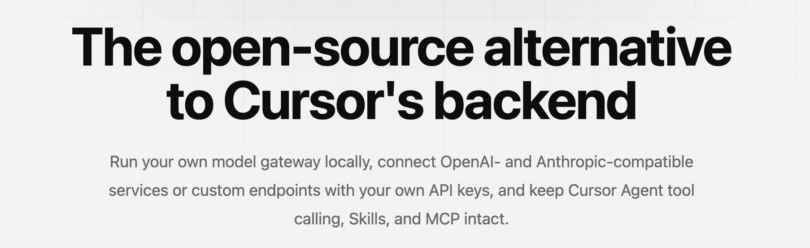
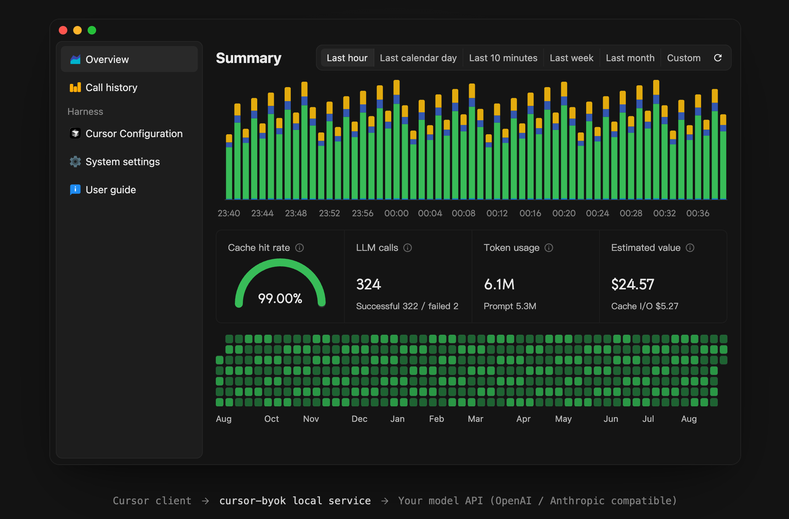

<div align="center">

# cursor-byok

[leookun/cursor-byok](https://github.com/leookun/cursor-byok) 已归档，本仓库是它的社区延续版本。<br>
cursor-byok 是一个运行在本机的 Cursor 模型网关，帮助你在 Cursor 中使用自己配置的模型服务。

[English README](./README.md) · [提交问题](https://github.com/HuZhenhan/cursor-byok-community/issues)

[](./LICENSE)
[](#项目简介)

</div>





## 项目简介

cursor-byok 是一个开源的本地模型网关。它在你的设备上运行服务，实现 Cursor 客户端依赖的后端接口，将模型请求转发到你配置的模型服务，并尽可能保留 Cursor Agent 的工具调用、Skills、MCP 和多轮对话能力。

你可以连接兼容 OpenAI 或 Anthropic 协议的服务，自定义服务地址、模型 ID、API Key 和请求参数，也可以使用 Cursor 平台默认选项之外的模型通道。

本项目延续自已经归档、停止维护的原版 cursor-byok。原作者停止更新后，Cursor 修改了客户端协议，导致 BYOK 在较新版本的 Cursor 中失效。社区版重新适配了当前 Cursor 协议，并由社区独立维护。

> [!IMPORTANT]
> cursor-byok 免费且开源，但你连接的模型服务商可能会按用量收费。本项目是独立项目，与 Cursor 或其开发者没有关联，也未获得其认可。

## 主要功能

- **适配当前 Cursor 协议**：同时支持 Cursor 默认使用的 HTTP/2 双向 `AgentService/Run` 流，以及 HTTP/1.1 下的 `RunSSE` / `BidiAppend` 回退路径。
- **自定义模型通道**：配置自己的 API 地址、凭据和模型 ID。
- **多种 API 协议**：支持 OpenAI Responses API、OpenAI Chat Completions API 和 Anthropic Messages API 兼容服务。
- **模型管理**：添加、复制、编辑、排序模型配置，批量测试连接，并从服务商获取模型列表。
- **连接性能测试**：查看首字延迟、生成速度、总耗时和原始服务商响应。
- **Agent 工作流**：继续使用工具调用、Skills、MCP 和多轮对话。
- **Cursor 中文支持**：为本地 Cursor 安装中文语言包。
- **本地 TAB 补全**：用已配置的 BYOK 模型生成 TAB 补全，也可让 TAB 请求直连 Cursor 官方服务或走自建中转。
- **会话指标**：查看 Token 用量、缓存命中率、对话轮次和估算价值。
- **跨平台运行**：支持 macOS、Windows 和 Linux。

## 数据流转

```text
Cursor 客户端
    │
    │ Agent 请求与工具结果
    ▼
cursor-byok 本地服务
    │
    │ OpenAI / Anthropic 兼容请求
    ▼
你配置的模型 API
```

API Key、模型配置和应用设置保存在本机。模型请求仍会发送到你选择的上游服务商，请根据对应服务商的隐私政策和计费规则使用。

## 更新日志

### 2026-11-13

- **版本号更新到 1.0.3**
  - **改动**：桌面应用、Tauri 安装包与窗口标题栏统一为 `1.0.3`（显示为 `Cursor 助手 v1.0.3`）。
  - **背景**：发布新的 GitHub Release 需要高于已发布 `1.0.2` 的版本号。

- **Agent 窗口左下角账号信息恢复加载**
  - **改动**：接管现在按 `iss: cursor-client` 识别旧版本写入的本地 token，并在发现旧 token 时重写 Cursor `state.vscdb` 中的 `cursorAuth/accessToken`、`cursorAuth/refreshToken` 与 `cursorAuth/stripeMembershipAuthId`，让 `DashboardService/GetMe` 等账号请求回到本地应答。重新接管后请重启 Cursor。
  - **根本原因**：本地 token 格式在版本之间发生了变化，而注入逻辑只要遇到与当前格式不同的非空 token 就跳过，把旧版 BYOK 写入的 token 误判为真实 Cursor 登录。账号请求因此带着该 token 转发到上游并返回 `401 Unauthorized`，Agent 窗口左下角的用户信息一直加载不出来，而设置页因为读取本地缓存值看起来仍然正常。

- **Cursor 安装位置支持手动指定，自动查找覆盖更多安装方式**
  - **改动**：**设置** → **Cursor 中文界面** 新增 **Cursor 安装位置**，显示当前使用的安装目录；**选择目录** 可手动指定（选中包含 `resources/app` 的 Cursor 文件夹即可），指定后可用 **自动查找** 恢复自动探测。自动探测新增 Windows `cursor://` 协议注册表项、`PATH` 中的 `Cursor.exe`、便携版与非默认目录，以及 macOS `.app` 与 Linux `PATH` 入口；`CURSOR_INSTALL_DIR` 环境变量仍然优先。指定目录后状态变为 **待应用**，点击 **重新应用** 才会写入语言包。
  - **背景**：安装在自定义目录或便携版的用户只会看到 **未找到 Cursor**，无法开启汉化，也没有任何补救入口。

- **模型行操作收纳为三点菜单**
  - **改动**：模型列表的每一行（表格视图、平铺视图以及插件模型）在 **操作** 列只显示一个 **⋯** 按钮，不再并排显示 **测试**、**编辑**、**复制**、**删除**。点击后弹出包含相同操作的菜单，测试进行中时 **测试** 变为 **取消测试**。操作列由约 140 px 收窄到 36 px，模型、供应商和备注列获得更多空间。
  - **根本原因**：每行四个并排按钮占满了表格右侧，在 940 px 最小窗口宽度下挤占了数据列，而且每行的视觉噪音大于它承载的数据。

- **模型导入导出移入系统设置**
  - **改动**：**Cursor** 页面操作区不再提供 **导出模型**；**设置** 页新增 **模型导入导出** 卡片，集中提供 **导出模型**、**导入模型** 和原有旧版配置导入。**导入模型** 通过系统文件选择器读取 `cursor-byok-models.json`，确认前显示新增与已存在的模型，确认后把新模型追加到列表末尾。
  - **根本原因**：此前只有导出、没有导入，模型配置只能单向带走；整表迁移操作也不适合放在日常管理模型列表的操作区。

- **导出的模型文件包含 API Key**
  - **改动**：导出的 JSON 现在保存完整模型配置，包括 API Key、扩展参数、自定义请求头、完整 URL 与端点设置，在其他设备或重装后导入即可还原全部字段。文件是包含密钥的明文，请妥善保管。
  - **根本原因**：导入要求每个模型的 API Key 非空，之前不含 Key 的导出文件无法还原出可用模型。

### 2026-11-12

- **Cursor 模型列表工具栏固定为单行**
  - **改动**：列表工具栏不再换行：视图切换、分组切换和批量操作共处一行；窗口默认以 1024 × 640 打开，最小宽度为 940 px（原先 820 × 558）。窗口再窄时工具栏整条横向滚动，而不是把批量操作折到第二行。
  - **根本原因**：换行会把批量操作挤到分组切换下方，勾选模型时下方表格会整体跳一行；原来 820 px 的窗口宽度也不够放下整条工具栏。

- **操作栏与模型表格限制在内容列内**
  - **改动**：页面操作栏现在同时锚定左右边界，窄窗口（例如 1024 px）下按钮不会再滑到侧边栏下方；操作项仍比内容列宽时改为横向滚动。**测试所选（n）** 和 **删除所选（n）** 只在至少勾选一个模型时出现。模型表格在窄窗口下改为横向滚动，不再裁掉上下文、备注、测速和操作列，各列宽度也一并收窄。模型表格也不会再把整页撑宽。
  - **根本原因**：操作栏只锚定右边界、没有左边界，所以过宽时整排按钮向左伸进侧边栏；表格网格本身需要约 930 px，超过 1024 px 窗口下的内容列宽度。另外页面网格列宽会被最宽的子元素撑开，表格的最小宽度把整页撑宽，右对齐的批量操作就被推到窗口外。

- **恢复全选并新增分组全选**
  - **改动**：表头提供 **全选** 勾选框，每个供应商/类型分组头部提供 **全选该分组** 勾选框，平铺视图在网格上方也有 **全选** 勾选框。三者都只在部分选中时显示半选状态；逐项勾选保持不变，勾选结果继续供 **测试所选（n）** 和 **删除所选（n）** 使用。
  - **背景**：批量测试和删除需要以整个列表或整个服务商为单位，几十个模型逐个勾选不现实。

- **导出模型改用系统另存为对话框**
  - **改动**：**导出模型** 现在弹出操作系统的另存为对话框，把 `cursor-byok-models.json` 写到指定路径，并在提示中给出保存位置；不再走浏览器下载。
  - **根本原因**：桌面窗口没有下载栏，浏览器下载要么把文件交给外部浏览器，要么静默什么都不产生。

- **Cursor 页操作区拆成两行**
  - **改动**：顶部操作行只保留页面级操作：接管开关、**批量添加**、**导出模型** 与添加模型按钮，不再遮挡页面标题 **Cursor**；列表正上方新增独立工具栏，放列表级操作：**表格 / 平铺**、**不分组 / 按供应商 / 按类型**，以及批量测试与删除（**一键测试**、**测试所选（n）**、**删除所选（n）**）。
  - **根本原因**：接管、视图、分组、测试、添加、导出原先挤在同一行悬浮操作栏上，还压在页面标题所在的位置；不相干的操作看起来像一组，窗口变窄时标题直接消失。

- **Cursor 模型默认以表格展示**
  - **改动**：Cursor 页面默认显示表格，列为模型、供应商、类型、上下文窗口、备注、测速与行内操作，并在拖拽列保留拖动排序；**平铺** 切回原来的卡片网格，视图切换与分组互不影响。
  - **根本原因**：默认卡片网格会让少量模型占用很多行，而旧控件把「平铺」和分组混成一组，已选分组时点平铺看起来没有反应。

- **选择改为逐项勾选并支持批量删除**
  - **改动**：表格行与卡片各有独立勾选框，**删除所选（n）** 在确认后删除勾选的模型。

- **批量添加改为常驻入口**
  - **改动**：工具栏上的 **批量添加** 始终可用，点击后打开独立弹窗：填写服务商类型、地址与 API Key，点 **获取模型**，再勾选要添加的模型或使用 **全部添加**。此前入口只存在于添加/编辑弹窗里、且必须先用过「获取模型」。
  - **根本原因**：接入一个服务商通常要一次添加很多模型，不应该从单条模型表单里开始。

- **显示名按模型标识自动生成**
  - **改动**：输入模型标识后，显示名按标题格式生成，并把末尾连续数字合并为版本号，例如 `claude-opus-5-5` → `Claude Opus 5.5`、`gpt-6.1-sol` → `GPT 6.1 Sol`；手动改过的名称不会被覆盖。
  - **背景**：显示名直接复制模型标识，Cursor 模型列表里显示的是带连字符的 slug。

- **修复中转站下跨资源会话状态报错**
  - **改动**：使用 OpenAI `/v1/responses` 端点的模型不再回放对话中保存的上游 reasoning item id。若上游仍返回「The requested item was created under a different Azure OpenAI resource」，BYOK 会在同一轮去掉全部状态重发一次；仍然失败时，错误会说明原因并提示新建会话或改回创建该状态的资源。
  - **根本原因**：Azure OpenAI 的 item id 只在创建它的资源内有效，而 agentrouter 这类中转会把同一个端点分发到多个资源；换 Key 或换中转后，旧对话每一轮都在发送当前资源读不到的 id。

- **测速结果常驻在模型条目上**
  - **改动**：连通性测试完成后会保存耗时与每秒 Token 数，模型卡片或列表行在提示消失、切换页面、重启应用后仍继续显示该速度，重新测试时用新结果覆盖。
  - **根本原因**：结果只存在页面的 React 状态里，任何重新挂载或重启都会丢失，测试的唯一痕迹只剩几秒后自动消失的提示。

- **模型备注改为选填**
  - **改动**：保存模型不再要求填写 **备注**，留空时按空字符串保存，添加与编辑弹窗中的该字段已标注为选填。
  - **根本原因**：弹窗校验与服务端模型校验都会拒绝空备注（服务端报错为「model tooltip cannot be empty」），导致本可跳过的说明文字变成必填项。

- **上下文窗口提供预设档位**
  - **改动**：添加与编辑弹窗的 **上下文窗口 Token** 字段新增 **128K**、**200K**、**356K**、**500K**、**800K**、**1M** 档位；再次点击已选档位会清空并回到默认值，数字输入框仍可填写任意自定义值。
  - **背景**：该字段填的是 Token 数，用户要表达「1M 上下文」必须手动输入 `1000000`；新增档位与 Cursor 自身的上下文分档一致。

- **支持导出全部模型配置**
  - **改动**：Cursor 页面操作区新增 **导出模型** 按钮，通过系统浏览器下载 `cursor-byok-models.json`，包含每个已配置模型的模型标识、显示名称、备注、分组、端点、上下文窗口与输出 Token 上限。文件中不包含 API Key。
  - **背景**：JSON 能完整保留额外参数与 Headers 等嵌套对象以及精确的 Token 数值，扁平化 CSV 会丢失这些结构；此前也无法把已配置的模型列表带出应用。

- **一键测试支持只测所选模型**
  - **改动**：模型卡片与列表行新增勾选框，工具栏新增 **测试所选（n）**，只测试被勾选的模型；**一键测试** 仍测试全部模型，批测进行中仍可切换为 **取消全部测试**。
  - **背景**：此前测试总是覆盖全部已配置模型，验证一个新接入的服务商要等所有模型跑完。

- **获取模型后支持批量添加**
  - **改动**：点击 **获取模型** 得到列表后，弹窗会列出发现的模型并支持勾选，提供整组的 **全部添加** 与 **批量添加（n）**；该端点下已配置的模型会被标记并跳过。原有单条添加流程（选中一个模型后保存）保持不变。
  - **背景**：一个服务商可能暴露数十个模型，逐个打开弹窗添加重复且低效。

- **版本号更新到 1.0.2**
  - **改动**：桌面应用、Tauri 安装包与 Rust crate 的版本号统一为 `1.0.2`。窗口标题栏仍以 `Cursor 助手 v1.0.2` 的形式展示安装包版本。
  - **背景**：将本轮教程移除与 Cursor 3.29 汉化修复作为一个新版本发布。

- **移除使用教程**
  - **改动**：删除应用内的 **使用教程** 菜单入口及其打开的站外教程链接，并从 `README.md` 与 `README-CN.md` 中移除快速开始、模型配置、Cursor 中文支持、TAB 补全服务与官方账号并存等教程章节。界面中不再保留指向已下线教程的菜单项、路由或链接。
  - **背景**：这些教程描述的是已归档原版项目的使用方式，其指向的文档站点也不再适用于本社区版本。

- **修复在新版本 Cursor 中无法正常使用的问题**
  - **改动**：新增 `agent.v1.AgentService/Run` 双向流处理，包括 Connect 帧解析、逐消息 gzip 解压、首帧模型选择、客户端帧接收，以及在同一条流上回传 kv 确认。原有的 `RunSSE` / `BidiAppend` 路径保留给回退到 HTTP/1.1 的客户端使用。
  - **根本原因**：Cursor 把默认的 Agent 传输方式从 HTTP/1.1 的 Connect 请求对（`RunSSE` 负责响应流、`BidiAppend` 负责客户端上行消息）改为 HTTP/2 上单条双向流 `AgentService/Run`，并启用了逐消息 gzip 压缩、把请求标识改放到 `x-request-id` 请求头。原实现只提供了 SSE 与 append 这一对接口，默认的 `Run` 请求根本到不了本地服务，BYOK 因此静默失效。

- **Cursor 退出后自动切换语言包**
  - **改动**：cursor-byok 会轮询 Cursor 进程；当 Cursor 从运行变为关闭时，查询 npm 上 `@polang233/cursor-language-pack` 的最新版本。若比已应用版本更新，就在后台下载并应用（连同 BYOK 补充词条），下次启动 Cursor 即生效。自动升级不会触发管理员提示：系统级安装留给用户手动点 **重新应用**，启动时也会等 Cursor 关闭后再改写文件。
  - **背景**：语言包按 Cursor 构建版本维护，版本落后会让新增界面继续显示英文；此前需要用户自己发现新版本并点 **重新应用**，而在 Cursor 运行时改写文件又可能与它已打开的文件冲突。

- **补齐 Cursor 3.29 的中文翻译**
  - **改动**：在语言包 1.1.4 之上新增带版本的补充词库，包含 2,156 条硬编码文案与 383 条 NLS 词条。完整汉化时在安装脚本改写程序文件前并入词库；两种模式都会把 NLS 词条写入已安装扩展的 `main.i18n.json`。补充词库版本会写入已应用记录，词库更新后会在下次启动时重新打补丁，不必等 Cursor 版本变化。
  - **背景**：上游语言包面向较旧的构建。扫描 Cursor 3.29.15 仍发现 2,447 条未翻译的硬编码文案和 389 条 NLS 词条，分布在 Agent 窗口、自动化、会话、快捷键、MCP 与设置中，这些文案要么在新版 bundle 中发生了变化，要么从未被语言包覆盖。

- **新增 Cursor 编辑器的中文语言支持**
  - **改动**：新增 **Cursor 中文界面** 设置，提供 **完整汉化** 与 **仅语言扩展** 两种汉化方式，并在 Cursor 版本变化后自动重新应用、在关闭时完整还原。
  - **背景**：Cursor 自身的界面文案编译在程序内部，并不由语言扩展提供，只安装语言包会让大部分 Cursor 专有界面仍显示英文。

- **修复原版 BYOK 模式下 Tab 自动补全功能失效的问题**
  - **改动**：TAB 补全改为默认由已配置的 BYOK 模型在本地生成。`StreamCpp` 响应按 Cursor 客户端的要求依次发送 `model_info`、`range_to_replace`（光标所在行）和整行重写后的文本，而不是只返回补全片段；提示词由光标处的前文与后文组成，并限制输出长度。对已启用思考的 OpenAI 类型模型自动关闭思考（`reasoning_effort: none`），保证首字延迟。TAB 设置新增 **TAB 模型** 选择，删除已下线的公益中转，保留 **直连** 与 **自定义** 两种转发方式。
  - **根本原因**：原版把 TAB 请求默认路由到作者托管的中转服务，该服务随项目归档一并下线，所有 TAB 请求都返回 `525`；同时 Cursor 新版客户端不再消费裸 `text` 响应，缺少 `model_info` 与 `range_to_replace` 时会把整条流判定为无效，不显示任何补全。

- **修复 Cursor 设置文件异常时启动即退出的问题**
  - **改动**：接管前清理 Cursor 旧代理配置失败时只记录警告，不再中断启动流程。
  - **根本原因**：`%APPDATA%\Cursor\User\settings.json` 中出现多个顶层 JSON 对象时解析失败，错误经 Tauri 的 setup 钩子触发 panic，窗口尚未创建进程就已退出。

## 项目结构

```text
cursor-byok/
├── apps/
│   ├── desktop/
│   │   ├── src/
│   │   │   ├── features/ # 首页、模型、调用记录与设置
│   │   │   ├── shell/    # 窗口框架、页面布局与广告外壳
│   │   │   ├── shared/   # UI、虚拟列表、状态、API 与平台能力
│   │   │   ├── demo/     # 浏览器演示环境的接口模拟
│   │   │   ├── i18n/     # 本地化运行时与语言目录
│   │   │   └── styles/   # 全局主题与排版令牌
│   │   └── src-tauri/    # Tauri 桌面生命周期
├── server/
│   ├── src/
│   │   ├── api/       # 本地 HTTP 接口与 Cursor 协议入口
│   │   ├── cursor/    # Cursor 协议适配
│   │   ├── run/       # 通用 Agent Runtime 与内部 Port
│   │   ├── provider/  # 模型供应商适配
│   │   ├── model/     # 聚合领域模型
│   │   ├── store/     # SQLite Repository
│   │   ├── control/   # 管理面 API
│   │   ├── local_app/ # Cursor 本地集成（接管、CA、TAB、中文支持）
│   │   ├── plugin/    # 插件运行时与目录
│   │   └── search/    # Web 与 Semble 搜索接入
│   ├── prompt/
│   ├── migrations/
│   └── plugins/
├── crates/
│   └── semble-core/   # 本地代码索引与搜索核心库
├── protocols/
│   └── cursor/        # Cursor 协议定义的唯一来源
├── support/                     # 仓库辅助设施
│   ├── cursor-protocol-extractor/ # Cursor 协议提取与 Go 代码生成工具
│   ├── cursor-capture/            # Cursor 协议抓取和调试工具
│   └── benchmarks/                # 代码搜索和索引基准测试
├── images/            # README 展示图片
├── Cargo.toml         # Rust 工作区配置
└── Makefile           # 常用开发、检查和构建命令
```

## 本地开发

### 环境要求

- Rust 工具链和 Cargo
- Node.js 与 npm
- Tauri 2 的系统构建依赖
- Docker（仅在构建 Docker 镜像时需要）

### 安装依赖

```bash
npm --prefix apps/desktop install
```

### 启动开发环境

启动桌面前端：

```bash
make dev-web
```

启动桌面应用：

```bash
make dev-desktop
```

### 检查与构建

运行完整检查：

```bash
make check
```

分别构建各部分：

```bash
make build-web       # 构建桌面前端
make build-server    # 构建 Rust 本地服务
make build-desktop   # 构建 Tauri 桌面安装包
make build-docker    # 构建 Docker 镜像
```

## 路线图

项目将继续改进模型协议兼容性、Agent 工具、本地运行稳定性和自托管体验，并探索支持更多 IDE、聊天和 Agent 工作流。

## 社区与反馈

- [GitHub Issues](https://github.com/HuZhenhan/cursor-byok-community/issues)
- [English README](./README.md)

提交问题时，请附上操作系统、cursor-byok 版本、模型类型、请求协议、已脱敏的服务地址、错误信息和复现步骤。请勿公开 API Key 或其他凭据。

## 参与贡献

欢迎提交 Issue 和 Pull Request。提交代码前请先阅读项目中的开发说明，并运行 `make check` 确认格式、测试和前端构建检查通过。

## 许可证

本项目采用 [MIT License](./LICENSE) 开源。
