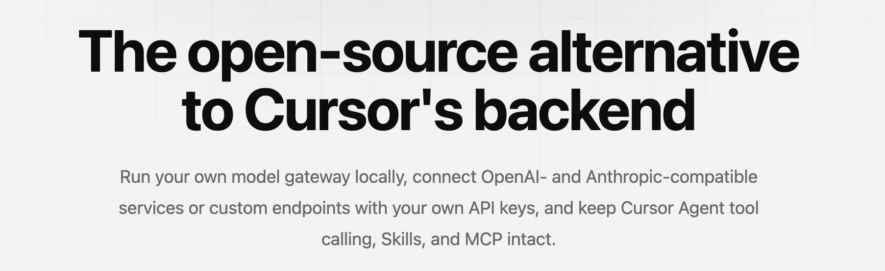
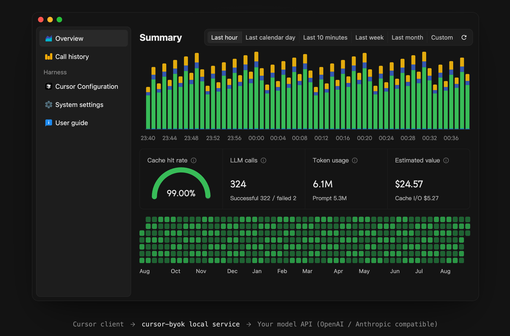

<div align="center">

# cursor-byok

A community-maintained continuation of the archived [leookun/cursor-byok](https://github.com/leookun/cursor-byok).<br>
It is a local model gateway that lets Cursor run on the model APIs you configure.

[中文说明](./README-CN.md) · [Report an Issue](https://github.com/HuZhenhan/cursor-byok-community/issues)

[](./LICENSE)
[](#about)

</div>





## About

cursor-byok is an open-source local model gateway for Cursor. It runs a service on your machine that implements the Cursor backend endpoints the client depends on, routes model requests to the providers you configure, and preserves Cursor Agent capabilities such as tool calling, Skills, and MCP.

You can connect OpenAI- and Anthropic-compatible services, customize endpoints, model IDs, API keys, and request parameters, and use model channels beyond the options built into the platform.

This repository continues the original project, which is archived and no longer maintained. The upstream author stopped updating it after Cursor changed its client protocol, which broke BYOK for current Cursor releases. This community edition tracks the current Cursor protocol again and is maintained independently of the original author.

> [!IMPORTANT]
> cursor-byok is free and open source, but the model APIs you connect may charge for usage. This is an independent project and is not affiliated with or endorsed by Cursor or its developers.

## Features

- **Current Cursor protocol:** Speak both the HTTP/2 bidirectional `AgentService/Run` stream that Cursor uses by default and the HTTP/1.1 `RunSSE` / `BidiAppend` fallback.
- **Bring your own model channels:** Configure your own API endpoint, credentials, and model IDs.
- **Multiple API protocols:** Use OpenAI Responses, OpenAI Chat Completions, or Anthropic Messages compatible APIs.
- **Model management:** Add, duplicate, edit, reorder, batch-test model configurations, and discover the model list from a provider.
- **Connection benchmarks:** Measure time to first token, generation speed, and inspect raw provider responses.
- **Agent workflows:** Keep tool calling, Skills, MCP, and multi-turn conversations available.
- **Cursor Chinese localization:** Apply a Chinese language pack to the local Cursor installation.
- **Local TAB completion:** Generate TAB completions with a configured BYOK model, or route TAB requests to Cursor's official endpoints or a relay you host yourself.
- **Session metrics:** Track token usage, cache hit rate, conversation turns, and estimated value.
- **Cross-platform:** Run on macOS, Windows, and Linux.

## How It Works

```text
Cursor client
    │
    │ Agent requests and tool results
    ▼
cursor-byok local service
    │
    │ OpenAI- / Anthropic-compatible requests
    ▼
Your model API
```

cursor-byok handles protocol adaptation, model request forwarding, tool-call coordination, and conversation state on your machine. API keys and application settings are stored locally; requests are still sent to the model provider you configure.

## Changelog

### 2026-11-13

- **Bumped the app version to 1.0.3**
  - **Change:** The desktop package, Tauri bundle, installers, and the window header now all report `1.0.3` (`Cursor 助手 v1.0.3`).
  - **Why it was needed:** A new GitHub Release needs a version newer than the published `1.0.2` build.

- **The Agent window account area loads the local account again**
  - **Change:** Takeover now recognizes local tokens written by earlier releases by their `iss: cursor-client` claim and rewrites `cursorAuth/accessToken`, `cursorAuth/refreshToken`, and `cursorAuth/stripeMembershipAuthId` in Cursor's `state.vscdb` when it finds one, so `DashboardService/GetMe` and the other account requests are answered locally. Restart Cursor after the takeover re-applies.
  - **Root cause:** The token format changed between releases, but the injection skipped any non-empty token that differed from the current one, treating the stale BYOK token as a real Cursor login. Account requests were then forwarded upstream with that token and rejected with `401 Unauthorized`, so the Agent window's bottom-left user info never loaded while cached values kept the Settings page looking normal.

- **The Cursor installation folder can be chosen manually, and detection covers more installs**
  - **Change:** **Settings** → **Cursor Chinese UI** gains a **Cursor installation folder** row that shows the folder in use and a **Choose folder** button for a manual path (pick the Cursor folder that contains `resources/app`); after setting one, **Auto-detect** restores automatic discovery. Automatic detection now also reads the Windows `cursor://` protocol registration, `Cursor.exe` on `PATH`, portable and custom install locations, macOS `.app` bundles, and Linux `PATH` entries; the `CURSOR_INSTALL_DIR` environment variable still takes precedence. After choosing a folder the state becomes **Pending**; press **Apply again** to install the language pack.
  - **Why it was needed:** Users who installed Cursor into a custom or portable location only saw **Cursor not found**, could not turn the feature on, and had no way to correct the path.

- **Model row actions collapse into a three-dot menu**
  - **Change:** Every model row (table view, tile view, and plugin models) now shows a single **⋯** button in the **Actions** column instead of separate **Test**, **Edit**, **Duplicate**, and **Delete** buttons. Clicking it opens a menu with the same actions, and **Test** becomes **Cancel test** while a test is running. The action column narrows from about 140 px to 36 px, giving the model, provider, and notes columns more room.
  - **Root cause:** Four inline buttons per row needed most of the right edge, so the data columns were squeezed at the 940 px minimum window width and every row looked busier than the data it carried.

- **Model import and export moved into Settings**
  - **Change:** The Cursor page actions no longer include **Export models**. A new **Model import and export** card on the Settings page holds **Export models**, **Import models**, and the existing legacy configuration import. **Import models** reads `cursor-byok-models.json` through the system file picker, shows which models are new and which already exist, and appends the new models to the end of the list after confirmation.
  - **Root cause:** Export shipped without a matching import, so a model list could only leave the app; whole-list transfer also does not belong in the toolbar used for day-to-day model management.

- **Exported model files now include API keys**
  - **Change:** The exported JSON stores the full model configuration, including the API key, extra parameters, custom headers, and full-URL and endpoint settings, so importing on another machine or after a reinstall restores every field. The file is plain text containing secrets; store it accordingly.
  - **Root cause:** Import requires a non-empty API key for every model, so the previous key-less export could not recreate a working model.

### 2026-11-12

- **Cursor model list toolbar stays on one row**
  - **Change:** The list toolbar no longer wraps: the view switch, the grouping switch, and the batch actions share one row, and the window opens at 1024 × 640 with a 940 px minimum width (previously 820 × 558). If a very narrow window still runs out of room, the toolbar scrolls horizontally instead of folding onto a second row.
  - **Root cause:** Wrapping pushed the batch actions under the grouping switch, so the table below jumped by a row whenever a model was selected; the old 820 px window was narrower than the toolbar needs.

- **Kept the toolbar and model table inside the content column**
  - **Change:** The page action bar is now bounded to the content column, so on narrow windows (for example 1024 px) its controls no longer slide under the sidebar; if the actions are still wider than the column they scroll horizontally. **Test selected (n)** and **Delete selected (n)** only appear when at least one model is checked. The model table now scrolls horizontally at narrow widths instead of cutting off the context, note, test-speed, and action columns, and its columns are narrower. The model table also no longer widens the whole page.
  - **Root cause:** The action bar was anchored only to the right edge with no left bound, so a wide toolbar extended leftwards under the sidebar; the table grid also required roughly 930 px, more than the content column provides at 1024 px windows. The page grid column was sized by its widest child, so the table's minimum width stretched the entire page and pushed the right-aligned batch actions past the window edge.

- **Restored select-all and added per-group select-all**
  - **Change:** The table header has a **Select all** checkbox, every provider or type group header has a **Select all in group** checkbox, and tile view has a **Select all** checkbox above the grid. All three show the indeterminate state when only part of their scope is checked, per-row checkboxes still work, and the selection feeds **Test selected (n)** and **Delete selected (n)**.
  - **Why it was needed:** Bulk testing and deleting need to start from the whole list or a whole provider, and checking every row by hand does not scale to a few dozen models.

- **Export models through a system save dialog**
  - **Change:** **Export models** now opens the operating system's save dialog and writes `cursor-byok-models.json` to the chosen path, reporting the saved path in a toast. It no longer hands the file to a browser download.
  - **Root cause:** The desktop window has no download shelf, so the browser download flow either opened an external browser or silently produced nothing.

- **Split the Cursor page actions into two rows**
  - **Change:** The top action row now holds only page-level actions: the takeover switch, **Batch add**, **Export models**, and the add-model button, so the **Cursor** page title is no longer covered. A separate toolbar directly above the list holds the list-level controls: **Table / Tiles**, **No grouping / By provider / By type**, and the batch test and delete actions (**Test all**, **Test selected (n)**, **Delete selected (n)**).
  - **Root cause:** Takeover, view, grouping, testing, adding, and exporting all shared one floating row that sat on top of the page title, so unrelated actions looked like one group and the title disappeared on narrower windows.

- **Cursor models open in a table by default**
  - **Change:** The Cursor page now defaults to a table with columns for the model, provider, type, context window, note, test speed, and row actions, and keeps drag-to-reorder in the handle column. **Tiles** switches to the previous card grid, and the view switch is now independent from grouping.
  - **Root cause:** The default card grid spread a few models over many rows, and the old control mixed "flat" with grouping modes, so choosing the tile layout while a grouping was active appeared to do nothing.

- **Selection is per model and batch delete is available**
  - **Change:** Each table row and card has its own checkbox, and **Delete selected (n)** removes the checked models after a confirmation.
  - **Why it was needed:** Selection drives per-model testing and deletion, so every model needs its own checkbox.

- **Batch add has a permanent toolbar entry**
  - **Change:** **Batch add** is always available in the toolbar and opens its own dialog: fill in the provider type, URL, and API key, choose **Fetch models**, then check the models to add or use **Add all**. Previously the entry only appeared inside the add/edit dialog after fetching models.
  - **Root cause:** Seeding a provider means adding many models at once, which should not require starting from a single-model form.

- **Display names are generated from the model ID**
  - **Change:** Typing a model ID fills the display name with title-cased words and joins trailing numbers into a version, so `claude-opus-5-5` becomes `Claude Opus 5.5` and `gpt-6.1-sol` becomes `GPT 6.1 Sol`. Manually edited names are kept.
  - **Why it was needed:** Display names were copied from the raw model ID, so the Cursor model list showed slugs with hyphens.

- **Fixed cross-resource reasoning state failures on relays**
  - **Change:** Models configured with the OpenAI `/v1/responses` endpoint no longer replay the upstream reasoning item ids stored in a conversation. If the upstream still answers "The requested item was created under a different Azure OpenAI resource", BYOK resends the same turn once with no stored state, and any remaining error now names the cause and asks for a new chat or the original resource.
  - **Root cause:** Azure OpenAI scopes item ids to the resource that created them, while relays such as agentrouter spread one endpoint across several resources, so a conversation that survived a key or relay switch kept sending ids the current resource could not read.

- **Kept model test speeds on each model entry**
  - **Change:** A connectivity test now stores its duration and tokens-per-second result, and the model card or row keeps showing that speed after the toast closes, after switching pages, and after restarting the app. Running the test again replaces the stored result.
  - **Root cause:** Results only lived in the page's React state, so any remount or restart dropped them and the only remaining evidence of a test was a toast that disappeared after a couple of seconds.

- **Made the model note optional**
  - **Change:** Saving a model no longer requires the **Notes** field, and an empty note is stored as an empty string. The field is labelled as optional in the add/edit dialog.
  - **Root cause:** The dialog and the model validation both rejected an empty note (the server rejected an empty model tooltip), so a description could not be skipped even though Cursor renders it as optional model text.

- **Added context window presets**
  - **Change:** The **Context window tokens** field in the add/edit dialog now offers **128K**, **200K**, **356K**, **500K**, **800K**, and **1M** presets; clicking the active preset clears the value back to the default. The numeric input still accepts any custom count.
  - **Why it was needed:** The field takes a token count, so users had to type `1000000` to express "1M context". The presets match the context buckets Cursor itself offers.

- **Added model list export**
  - **Change:** Added an **Export models** button to the Cursor page actions. It downloads `cursor-byok-models.json` through the system browser, containing the model identifier, display name, note, group, endpoint, context window, and output/token limits of every configured model. API keys are left out of the file.
  - **Why it was needed:** JSON keeps the nested extra-parameter and header objects and the exact token counts readable, which a flattened CSV would lose, and there was previously no way to take the configured list out of the app.

- **Added partial connectivity tests**
  - **Change:** Each model card and row has a selection checkbox, and the toolbar gained **Test selected (n)**, which tests only the checked models. **Test all** still runs the whole list and still turns into **Cancel all tests** while a batch is running.
  - **Why it was needed:** Testing always covered every configured model, so verifying one newly added provider meant waiting for all of them.

- **Added batch model adding after discovery**
  - **Change:** After **Fetch models** returns a list, the dialog lists the discovered models with checkboxes, an **Add all** button for the whole group, and **Add selected (n)**. Models already configured for that endpoint are marked and skipped. The original single-model flow (pick one model, then **Save**) is unchanged.
  - **Why it was needed:** A provider can expose dozens of models, and adding them one dialog at a time was repetitive.

- **Bumped the app version to 1.0.2**
  - **Change:** The desktop package, Tauri bundle, and Rust crate now all report `1.0.2`. The window header still shows the bundle version as `Cursor 助手 v1.0.2`.
  - **Why it was needed:** Marks the release that removes the outdated tutorials and carries the Cursor 3.29 localization fixes.

- **Removed the usage tutorials**
  - **Change:** Removed the **User guide** menu entry and the external tutorial it opened, and deleted the Quick Start, model setup, Cursor Chinese UI, TAB completion, and account coexistence walkthroughs from `README.md` and `README-CN.md`. No menu item, route, or link to the retired tutorial remains.
  - **Why it was needed:** Those walkthroughs described the workflow of the archived upstream project, and the documentation site they pointed to no longer applies to this community edition.

- **Restored BYOK on current Cursor releases**
  - **Change:** Added the `agent.v1.AgentService/Run` bidirectional stream handler, including Connect frame decoding, per-message gzip decompression, first-frame model selection, client frame ingestion, and kv acknowledgement on the same stream. The existing `RunSSE` / `BidiAppend` path is kept for clients that fall back to HTTP/1.1.
  - **Root cause:** Cursor moved its default agent transport from the HTTP/1.1 Connect pair (`RunSSE` for the response stream plus `BidiAppend` for client-to-server messages) to a single HTTP/2 bidirectional stream on `AgentService/Run`, and turned on per-message gzip compression with the request identity carried in the `x-request-id` header. The previous implementation only served the SSE/append pair, so the default `Run` request never reached the local service and BYOK silently stopped taking effect.

- **Switched Cursor language packs automatically after Cursor exits**
  - **Change:** cursor-byok now polls the Cursor process, and when Cursor goes from running to closed it asks the npm registry for the latest `@polang233/cursor-language-pack` version. If the release is newer than the applied one it is downloaded and applied in the background, together with the BYOK supplement, and takes effect on the next Cursor launch. Upgrades never trigger an administrator prompt: system-wide installs are left for an explicit **Re-apply**, and startup also waits for Cursor to be closed before rewriting files.
  - **Why it was needed:** The pack is versioned against Cursor builds, and a pack that falls behind leaves newly added screens in English. Users previously had to notice a release and press **Re-apply** themselves, while patching a running Cursor risks conflicting with files it has open.

- **Completed the Chinese translation for Cursor 3.29**
  - **Change:** Added a versioned supplement of 2,156 hardcoded strings and 383 NLS entries on top of language pack 1.1.4. In **Full translation** mode the supplement is merged into the pack dictionary before the installer rewrites the program files; in both modes the NLS entries are written into the installed extension's `main.i18n.json`. The supplement version is stored with the applied record, so an updated dictionary re-patches the current Cursor install on the next startup instead of waiting for a version change.
  - **Why it was needed:** The upstream pack targets older builds. Scanning Cursor 3.29.15 still found 2,447 untranslated hardcoded strings and 389 NLS entries across the Agent window, automations, sessions, keybindings, MCP, and settings, because those strings either changed in the new bundles or were never covered by the pack.

- **Added Chinese localization for the Cursor editor**
  - **Change:** Added the **Cursor Chinese UI** setting with **Full translation** and **Extension only** modes, plus automatic re-application when the Cursor version changes and full restoration when the option is disabled.
  - **Why it was needed:** Cursor's own interface strings are compiled into the application instead of being supplied by a language extension, so installing a pack alone leaves most Cursor-specific screens in English.

- **Fixed TAB completion in BYOK mode**
  - **Change:** TAB completion is now generated locally by a configured BYOK model. `StreamCpp` responses follow what the Cursor client expects: `model_info`, then `range_to_replace` for the cursor line, then the rewritten full line instead of only the inserted fragment. The prompt splits the current file at the cursor, output length is capped, and reasoning is turned off (`reasoning_effort: none`) for OpenAI-style models that had it enabled so the first token stays fast. TAB Settings gained a **TAB model** picker, the retired public relay was removed, and **Direct** plus **Custom** forwarding remain available.
  - **Root cause:** TAB requests were routed by default to the relay the original author hosted. That relay went offline together with the archived project, so every TAB request failed with `525`. Current Cursor clients also no longer consume a bare `text` response: without `model_info` and `range_to_replace` they treat the whole stream as invalid and show nothing.

- **Fixed an immediate exit on startup when the Cursor settings file is malformed**
  - **Change:** Failing to clean stale Cursor proxy settings before takeover is now logged as a warning instead of aborting startup.
  - **Root cause:** `%APPDATA%\Cursor\User\settings.json` contained two top-level JSON objects, which failed to parse; the error propagated through the Tauri setup hook and panicked before the window was created, so the process exited with no UI.

## Why This Project

Many Agent products bundle their tool capabilities with a fixed set of models, subscriptions, and billing options, leaving users limited to the channels offered by the platform.

cursor-byok is built to return model choice to the user. Developers can make full use of the APIs and credits they already have, choose the models and providers that fit their needs, and self-host related services when required.

## Roadmap

The project will continue to improve model compatibility, Agent tooling, local runtime stability, and the self-hosting experience while exploring support for more IDE, chat, and Agent workflows.

## Community and Support

- [GitHub Issues](https://github.com/HuZhenhan/cursor-byok-community/issues)
- [中文说明](./README-CN.md)

When reporting a problem, include your operating system, cursor-byok version, model type, request protocol, a redacted service address, the error message, and the steps to reproduce. Never post API keys or other credentials.

## Development and Contributing

Issues and pull requests are welcome.

Requirements: a Rust toolchain with Cargo, Node.js with npm, the Tauri 2 system dependencies, and Docker only when building the container image.

```bash
npm --prefix apps/desktop install   # install frontend dependencies
make dev-web                        # run the desktop frontend
make dev-desktop                    # run the desktop application
make check                          # format, test, and build checks
make build-desktop                  # build the Tauri desktop package
```

Run `make check` before opening a pull request.

## License

This project is open source under the [MIT License](./LICENSE).
